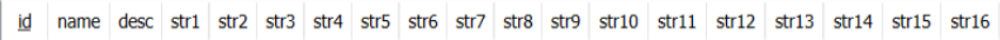
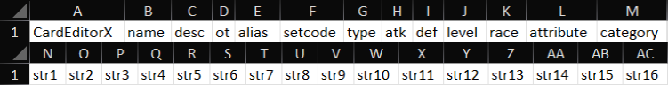
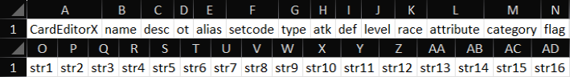
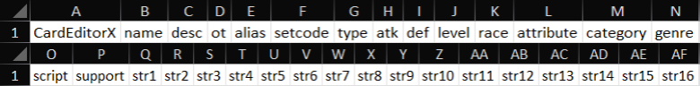

# Card Database Structure

This document defines the card data structures supported by CardEditorX and the formats that can be used to store and exchange card data.

DataEditor is a data management module of CardEditorX. It is designed to load, process, and exchange card data using several supported Card Database formats.

Although Yu-Gi-Oh! game engines commonly use SQLite databases with the `.cdb` extension, DataEditor is not tied to the .cdb format. Instead, it works with a common Card List structure that can be represented by multiple file formats.

As a result, a **Card List File** does not need to use a specific file extension to be compatible with **DataEditor**. The input only needs to provide the required card fields and follow the structure defined for the corresponding format.

## Supported Formats

CardEditorX currently supports the following Card Database formats:

|    Format    |         Supported Extensions         |
|--------------|--------------------------------------|
|SQLite        |`*.cdb`, `*.db`, `*.bytes`, `*.sqlite`|
|Excel         |`*.xlsx`, `*.xlsm`, `*.xltx`, `*.xltm`|
|JSON          |`*.ceds`, `*.json`, `*.txt`           |

The file format itself is not the primary requirement. As long as the file can provide a **compatible Card List structure**, DataEditor can use it as a card data source.

Each format has its own structure and requirements, which are described in the sections below.

## **Required Card List Structure**

The following images illustrate the required Card List structure for each supported file format.

## I. SQLite Database (`*.db`, `*.cdb`, `*.sqlite`)

DataEditor currently supports three SQLite Card Database formats:

- YGO without Flag
- YGO with Flag
- OMEGA 

Although these formats share the same general **Card Database** concept, their **table** structures are NOT identical. In particular, the `texts` table uses the same structure across all three formats, while the `datas` table has a different structure for each format.

### `texts` Table

All three supported SQLite formats — `YGO Without Flag`, `YGO With Flag`, and `OMEGA` — use the same texts table structure.



The texts table must contain at least the following columns:

|  Column      |       Description       |
|--------------|-------------------------|
| id           |Unique card identifier   |
| name         |Card name                |
| desc         |Card description         |
| str1 ~ str16 |Card String              |

### `datas` Table

Each supported SQLite format uses a different datas table structure.

### **1. YGO Without Flag**


The YGO Without Flag format uses the original YGO datas table structure.

The table must contain the following columns:

```
id, ot, alias, setcode, type, atk, def, level, race, attribute, category
```

### **2. YGO With Flag**


The YGO With Flag format uses the original YGO datas table structure, with an additional flag column added after the category column.

The table must contain the following columns:

```
id, ot, alias, setcode, type, atk, def, level, race, attribute, category, flag
```

### **3. OMEGA**


The table must contain the following columns:

```
id, ot, alias, setcode, type, atk, def, level, race, attribute, category, genre, script, support
```

This format is designed exclusively for YGO OMEGA. The datas table includes the following additional columns:

- `genre` (YGO OMEGA Category)
- `script` (YGO OMEGA stores Card Scripts directly in the database instead of separating them into external `*.lua` files)
- `support` (additional support codes for Cards)
- Additionally, the `category` column serves as the `flag` in this format.

### Card Record Association

For all supported SQLite formats, the id field is used to associate records between the texts and datas tables.

For example:
```text
texts.id = 611000000
datas.id = 611000000

 Both records represent the same card.
```

A SQLite database is considered compatible with DataEditor as long as it provides the required texts and datas tables with the appropriate structure for one of the supported SQLite formats.

Additional tables and columns are allowed, provided that they do not conflict with the required tables and columns. They do not affect compatibility with DataEditor.

## II. Excel Database (`.xlsx`, `.xlsm`, `.xltx`, `.xltm`)

For Excel databases, DataEditor expects card data to be stored in the first worksheet using a fixed column structure.

The first row of the worksheet is treated as the header row. DataEditor uses this header to determine whether the worksheet conforms to the required structure.
Card records start from row 2.

DataEditor currently supports three Excel Database formats:

- YGO without Flag
- YGO with Flag
- OMEGA 

### **1. YGO Without Flag**



> **Column Mapping**

Each Excel column corresponds to a field in the Card Database:

| Excel Column | Card Database Field |
|--------------|---------------------|
| A            | `id`                |
| B            | `name`              |
| C            | `desc`              |
| D            | `ot`                |
| E            | `alias`             |
| F            | `setcode`           |
| G            | `type`              |
| H            | `atk`               |
| I            | `def`               |
| J            | `level`             |
| K            | `race`              |
| L            | `attribute`         |
| M            | `category`          |
| N            | `str1`              |
| O            | `str2`              |
| P            | `str3`              |
| Q            | `str4`              |
| R            | `str5`              |
| S            | `str6`              |
| T            | `str7`              |
| U            | `str8`              |
| V            | `str9`              |
| W            | `str10`             |
| X            | `str11`             |
| Y            | `str12`             |
| Z            | `str13`             |
| AA           | `str14`             |
| AB           | `str15`             |
| AC           | `str16`             |

> **Header Structure**

The first row of the Excel file must contain the following headers:

| Cell |    Header    |
|------|--------------|
|  A1  | `CardEditorX`|
|  B1  | `name`       |
|  C1  | `desc`       |
|  D1  | `ot`         |
|  E1  | `alias`      |
|  F1  | `setcode`    |
|  G1  | `type`       |
|  H1  | `atk`        |
|  I1  | `def`        |
|  J1  | `level`      |
|  K1  | `race`       |
|  L1  | `attribute`  |
|  M1  | `category`   |
|  N1  | `str1`       |
|  O1  | `str2`       |
|  P1  | `str3`       |
|  Q1  | `str4`       |
|  R1  | `str5`       |
|  S1  | `str6`       |
|  T1  | `str7`       |
|  U1  | `str8`       |
|  V1  | `str9`       |
|  W1  | `str10`      |
|  X1  | `str11`      |
|  Y1  | `str12`      |
|  Z1  | `str13`      |
|  AA1 | `str14`      |
|  AB1 | `str15`      |
|  AC1 | `str16`      |

### **2. YGO With Flag**



> **Column Mapping**

Each Excel column corresponds to a field in the Card Database:

| Excel Column | Card Database Field |
|--------------|---------------------|
| A            | `id`                |
| B            | `name`              |
| C            | `desc`              |
| D            | `ot`                |
| E            | `alias`             |
| F            | `setcode`           |
| G            | `type`              |
| H            | `atk`               |
| I            | `def`               |
| J            | `level`             |
| K            | `race`              |
| L            | `attribute`         |
| M            | `category`          |
| N            | `flag`              |
| O            | `str1`              |
| P            | `str2`              |
| Q            | `str3`              |
| R            | `str4`              |
| S            | `str5`              |
| T            | `str6`              |
| U            | `str7`              |
| V            | `str8`              |
| W            | `str9`              |
| X            | `str10`             |
| Y            | `str11`             |
| Z            | `str12`             |
| AA           | `str13`             |
| AB           | `str14`             |
| AC           | `str15`             |
| AD           | `str16`             |

> **Header Structure**

The first row of the Excel file must contain the following headers:

| Cell |    Header    |
|------|--------------|
|  A1  | `CardEditorX`|
|  B1  | `name`       |
|  C1  | `desc`       |
|  D1  | `ot`         |
|  E1  | `alias`      |
|  F1  | `setcode`    |
|  G1  | `type`       |
|  H1  | `atk`        |
|  I1  | `def`        |
|  J1  | `level`      |
|  K1  | `race`       |
|  L1  | `attribute`  |
|  M1  | `category`   |
|  N1  | `flag`       |
|  O1  | `str1`       |
|  P1  | `str2`       |
|  Q1  | `str3`       |
|  R1  | `str4`       |
|  S1  | `str5`       |
|  T1  | `str6`       |
|  U1  | `str7`       |
|  V1  | `str8`       |
|  W1  | `str9`       |
|  X1  | `str10`      |
|  Y1  | `str11`      |
|  Z1  | `str12`      |
|  AA1 | `str13`      |
|  AB1 | `str14`      |
|  AC1 | `str15`      |
|  AD1 | `str16`      |

### **3. OMEGA**



> **Column Mapping**

Each Excel column corresponds to a field in the Card Database:

| Excel Column | Card Database Field |
|--------------|---------------------|
| A            | `id`                |
| B            | `name`              |
| C            | `desc`              |
| D            | `ot`                |
| E            | `alias`             |
| F            | `setcode`           |
| G            | `type`              |
| H            | `atk`               |
| I            | `def`               |
| J            | `level`             |
| K            | `race`              |
| L            | `attribute`         |
| M            | `category`          |
| N            | `genre`             |
| O            | `script`            |
| P            | `support`           |
| Q            | `str1`              |
| R            | `str2`              |
| S            | `str3`              |
| T            | `str4`              |
| U            | `str5`              |
| V            | `str6`              |
| W            | `str7`              |
| X            | `str8`              |
| Y            | `str9`              |
| Z            | `str10`             |
| AA           | `str11`             |
| AB           | `str12`             |
| AC           | `str13`             |
| AD           | `str14`             |
| AE           | `str15`             |
| AF           | `str16`             |

> **Header Structure**

The first row of the Excel file must contain the following headers:

| Cell |    Header    |
|------|--------------|
|  A1  | `CardEditorX`|
|  B1  | `name`       |
|  C1  | `desc`       |
|  D1  | `ot`         |
|  E1  | `alias`      |
|  F1  | `setcode`    |
|  G1  | `type`       |
|  H1  | `atk`        |
|  I1  | `def`        |
|  J1  | `level`      |
|  K1  | `race`       |
|  L1  | `attribute`  |
|  M1  | `category`   |
|  N1  | `flag`       |
|  O1  | `str1`       |
|  P1  | `str2`       |
|  Q1  | `str3`       |
|  R1  | `str4`       |
|  S1  | `str5`       |
|  T1  | `str6`       |
|  U1  | `str7`       |
|  V1  | `str8`       |
|  W1  | `str9`       |
|  X1  | `str10`      |
|  Y1  | `str11`      |
|  Z1  | `str12`      |
|  AA1 | `str13`      |
|  AB1 | `str14`      |
|  AC1 | `str15`      |
|  AD1 | `str16`      |

---

> **Note:** The header row must follow this structure exactly. `A1` must contain `CardEditorX`.
This value is used to identify the worksheet as a CardEditorX-compatible Card Database.

---

## III. Text Database (`*.txt`, `*.ceds`)

DataEditor supports text-based Card Database files using the `*.txt` and `*.ceds` formats.
The file contains a JSON array of Card objects. Each object represents one card record.

Both `.txt` and `.ceds` files use the same JSON-based structure.

A basic example:

```json
[
  {
    "id": 611000000,
    "name": "Card Name",
    "desc": "...",
    "str1": "",
    "str2": "",
    "str3": "",
    "str4": "",
    "str5": "",
    "str6": "",
    "str7": "",
    "str8": "",
    "str9": "",
    "str10": "",
    "str11": "",
    "str12": "",
    "str13": "",
    "str14": "",
    "str15": "",
    "str16": "",
    "ot": 1,
    "alias": 10000000,
    "setcode": 0,
    "type": 33,
    "atk": 0,
    "def": 0,
    "level": 1,
    "race": 2,
    "attribute": 64,
    "category": 0,
    "flag": 0
  }
]

```

- Note: `flag` is an optional field and is not required for compatibility.

Each JSON object is converted to a Card data object when loaded by DataEditor and serialized back to JSON when the database is written.

The format may contain additional fields that are not part of the minimum Card Database structure.

### Compatibility

DataEditor does not require a specific file format as long as the input provides a compatible Card List structure.
Custom databases and additional fields are allowed, provided that the required structure for the corresponding format is available.

This allows card data to be exchanged between CardEditorX and external tools without requiring the data to be stored in a specific format.


[← Previous: DataEditor](../Language/English/Windows/DataEditor.md)

