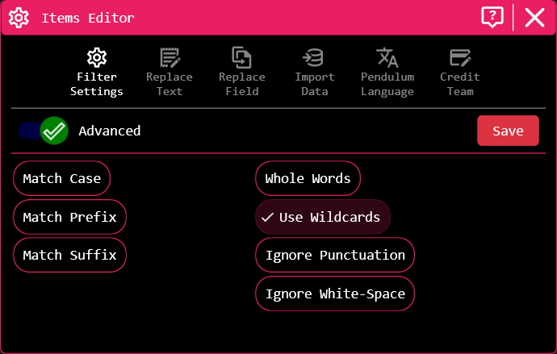
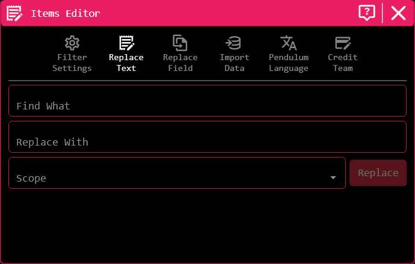
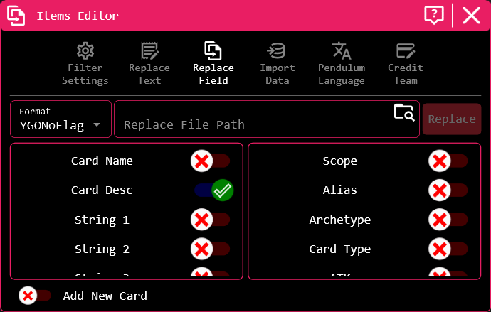
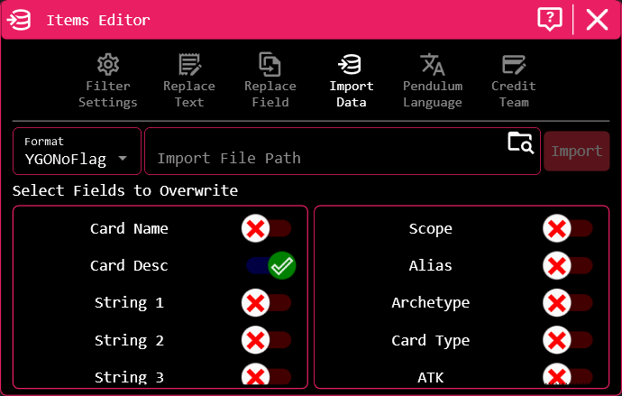
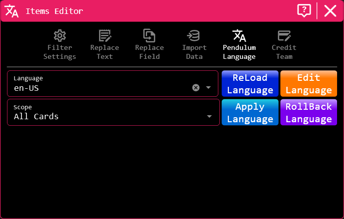
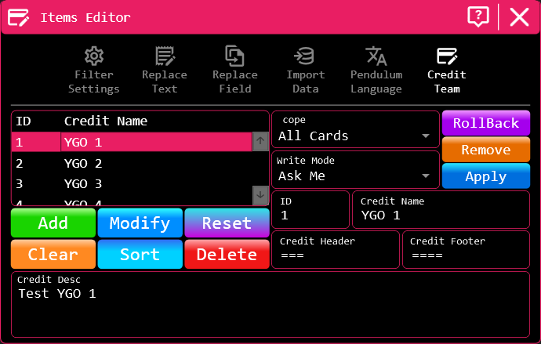

# Item Editor

## Overview

Item Editor provides a collection of tools for managing and modifying card data in CardEditorX.

It allows users to perform text replacement, selective field updates, data imports, and specialized operations on card descriptions. These operations can be applied to multiple cards at once, reducing the need for manual editing.

Item Editor is accessible through **Data → Item Editor** and is available only when one of the supported data editing tabs is active.

## Supported Tabs

Item Editor is only available in the following tabs:

- **DataEditor** – Works with YGO Card Data (YGOPro, EDOPro, MDPro).
- **OmegaDataEditor** – Works with Omega Card Data (YGO OMEGA).
- **BanListEditor** – Works with BanList Card Data.

The available operations may vary depending on the active tab. In particular, **Pendulum Language** and **Credit Team** are only available in DataEditor and OmegaDataEditor.

## Filter Settings



Filter Settings provides configuration options for text matching operations.

These settings determine how text is matched when performing operations such as Replace Text.

The available options are:

| Option                 | Description |
|------------------------|-------------|
| **Advanced Filter**    | Enables advanced filtering rules. |
| **Match Case**         | Makes text matching case-sensitive. |
| **Match Prefix**       | Matches text at the beginning of a word or text segment. |
| **Match Suffix**       | Matches text at the end of a word or text segment. |
| **Whole Words**        | Matches complete words rather than partial word occurrences. |
| **User Wildcards**     | Enables wildcard characters in the search pattern. |
| **Ignore Punctuation** | Ignores punctuation when matching text. |
| **Ignore White-Space** | Ignores whitespace characters when matching text. |

These settings provide greater control over text matching without requiring users to modify the original card descriptions manually.

## Replace Text



Replace Text searches for specified text in card descriptions and replaces matching occurrences with another text value.

The interface provides the following fields:

- **Find What** – The text to search for.
- **Replace With** – The replacement text.
- **[Scope](../../Concepts/Scope.md)** – Determines which cards are processed.

When executed, the operation:

1. Retrieves the items included in the selected Scope.
2. Reads the description (`Item.desc`) of each item.
3. Searches for occurrences matching the specified Find What value.
4. Replaces matching occurrences with the Replace With value.

Text matching follows the configuration defined in Filter Settings.

## Replace Field



Replace Field updates selected fields of existing items using data imported from an external file. It can also optionally add new items that do not already exist in the current Item List.

The interface allows users to:

- Select an input file.
- Choose a Data Format.
- Select one or more fields to replace.
- Enable or disable **Add New Card**.


At least one field must be selected before executing this operation.

The application reads the imported data into a separate collection, referred to as the [Additional List](../../Concepts/ItemList.md#additional-list), and compares its items against the current Item List using their IDs.

The operation follows these rules:

**Existing Items**

If an imported item has an ID that already exists in the Item List, only the selected fields are copied from the imported item to the existing item.

Fields that are not selected remain unchanged.

**New Items**

If an imported item has an ID that does not exist in the Item List:

- When **Add New Card** is enabled, the item is added to the Item List with all its fields.
- When **Add New Card** is disabled, the item is ignored.

Replace Field does not use Scope.

## Import Data



Import Data imports items from an external file into the current Item List.

The interface allows users to:

- Select an input file.
- Choose a Data Format.
- Select the fields to update on existing items.

Unlike Replace Field, selecting fields is optional. Users can execute Import Data without selecting any fields.

The application reads the imported data into the Additional List and compares each imported item against the current Item List using its ID.

The operation follows these rules:

**New Items**

If an imported item's ID does not exist in the current Item List, the item is added with all its fields.

**Existing Items**

If an imported item's ID already exists in the current Item List, only the selected fields are updated.

If no fields are selected, existing items are left unchanged.

Import Data does not use Scope.

## Pendulum Language



Pendulum Language converts the description format of Pendulum Cards between supported languages.

This feature is available only in **DataEditor** and **OmegaDataEditor**.

Different card display systems may require different Pendulum Description formats for different languages. Using an incompatible format can interfere with how the game renders card images and text.

Pendulum Language automatically identifies the existing description format and converts it into the format required by the selected target language. Users do not need to manually identify the source language or filter Pendulum Cards beforehand.

To apply a language conversion:

1. Select the target language from the language ComboBox.
2. Choose the desired Scope.
3. Click **Apply language**.

The application identifies Pendulum Cards within the selected Scope and converts their descriptions to the selected language format.

This operation converts the description format; it does not translate the actual card text.

**Rollback**

Pendulum Language supports Rollback, allowing users to restore the descriptions to their state before the most recent Apply operation.

Rollback is single-level. Only the most recent Apply operation can be undone. Rollback data is temporary and is lost when CardEditor is closed.


## Credit Team



Credit Team manages attribution information added to card descriptions.

It is available only in **DataEditor** and **OmegaDataEditor**.

Instead of manually appending attribution text to each card description, users can create and manage reusable Credit entries in the Credit Database.

### Credit Database

The Credit Database is stored in a separate file created inside the CardEditor folder.

Each Credit entry contains the following information:

| Field | Description |
|---|---|
| **ID** | The unique identifier of the Credit entry. |
| **Credit Name** | The name used to identify the Credit entry. |
| **Credit Header** | The text marking the beginning of the applied Credit. |
| **Credit Footer** | An optional text marking the end of the applied Credit. |
| **Credit Desc** | The attribution text included in the Credit. |

#### Apply Credit

To apply a Credit:

1. Create or select a Credit entry from the Credit Database.
2. Choose the desired Scope.
3. Click **Apply**.

The selected Credit is added to the descriptions of all cards within the selected Scope.

The applied Credit follows this structure:

When Credit Footer is specified:

```text
[Credit Header]
Credit Desc
[Credit Footer]
```

When Credit Footer is not specified, the Credit extends from Credit Header to the end of the card description.

Each card can contain only one applied Credit at a time. When a new Credit is applied, the previously applied Credit is removed before the new one is added.

#### Remove Credit

Remove deletes the applied Credit from cards within the selected Scope.

The application identifies the Credit by its Credit Header:

- If Credit Footer is specified, the Credit region extends from Credit Header through Credit Footer.
- If Credit Footer is not specified, the Credit region extends from Credit Header to the end of the card description.

Only cards included in the selected Scope are affected.

#### Rollback

Credit Team supports Rollback, allowing users to restore card descriptions to their state before the most recent Apply operation.

Rollback is single-level. Only the most recent Apply operation can be undone. Rollback data is temporary and is lost when CardEditor is closed.

