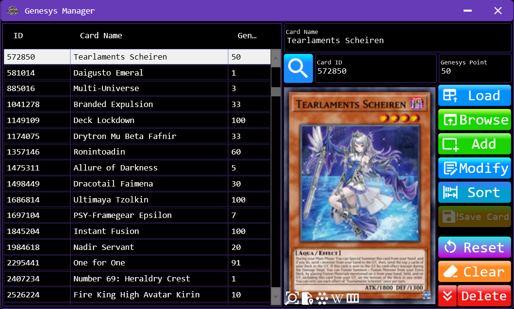

# Genesys Manager

Genesys Manager allows users to manage the Genesys Point system and assign Genesys Points to individual cards.

In the Yu-Gi-Oh! Card Game Genesys Format, cards are assigned point values instead of being regulated by a Banlist as in OCG and TCG formats. The total Genesys Points of a Deck must not exceed the point limit established for the tournament.

Genesys Manager provides a centralized interface for managing these point values.

## Overview

Genesys Card Manager manages the Genesys Point values assigned to individual cards. This data is stored in the Genesys Card Database.

1. Data Management

- Load: Loads Genesys Card data from the database and displays it in the View.
- Add: Adds a new Genesys Card entry to the View and immediately saves that item to the database.
- Modify: Edits an existing Genesys Card entry in the View and immediately saves the modified item to the database.
- Save: Saves the entire list in the View to the database. This operation is required after importing data through either of the Browse features.
- Reset: Restores the selected Genesys Card's displayed data to its original state.
- Clear: Clears the data currently displayed in the View.

>Note: The Add and Modify operations save their respective items immediately. In contrast, data imported through the Browse features is not saved automatically.

2. Sorting and Filtering

- Sort: Sorts the Genesys Card list according to the sorting order configured in Settings.
- Filter/Search: Filters the Genesys Card list displayed in the View based on the specified search criteria.

Filtering affects which entries are displayed and can be used to narrow the list before performing operations such as Delete Found Card.

3. Deleting Genesys Cards

The Genesys Card Manager provides four deletion operations with different scopes.

|  Operation            |          Description            |
|-----------------------|---------------------------------|
| Delete                | Deletes the currently selected item. If multiple items are selected, only the last selected item is deleted.
| Delete Selected Card  | Deletes all items currently selected in the Genesys Card list.
| Delete Found Card     | Deletes all items currently displayed in the list after the active filtering or search conditions have been applied.
| Delete All Card       | Deletes all Genesys Card entries, regardless of the current filtering or search conditions.

>Warning: These operations can remove multiple entries at once. Pay particular attention to the deletion scope, especially when using Delete Found Card or Delete All Card.

4. Browse Card Data

Select a file to import card data into the View.

Supported file formats:

- Card Database (SQLite): `*.cdb`, `*.db`, `*.bytes`, `*.sqlite`
- Excel: `*.xlsx`, `*.xlsm`, `*.xltx`, `*.xltm`
- Text: `*.ceds`, `*.json`, `*.txt`

The imported data depends on the selected file type:

- Card List (`SQLite`, `Excel`, `JSON`): Import only the Card ID and Card Name for each card. The Card Genesys Point is set to 0.
- Genesys Card List (`.cdb` `.txt`): Imports the Card ID, Card Name, and Card Genesys Point of each card.

For the file structures, refer to:

- [View Card List Structure](../../../Structure/English/CardListStructure.md)
- [View Genesys Card Structure](../../../Structure/English/GenesysCardStructure.md)

To import cards with their Genesys Point values:

- Visit the official Yu-Gi-Oh! Genesys website.
- Copy the list of Genesys Point values from the website.
- Paste the copied data into a text file (.txt).
- Select the text file using Browse to import the data into the View.

After reviewing the imported data, click Save to save the entire list currently displayed in the View to the Rarity Card Database.

>Important: The Browse operations only update the View. They do not save imported entries to the database automatically.

---

[← Previous: DeckEditor](../Windows/DeckEditor.md)&nbsp;&nbsp;&nbsp;||&nbsp;&nbsp;&nbsp;[Next: Rarity Manager →](../Manager/RarityManager.md)

[← Getting Started](../GettingStarted.md)