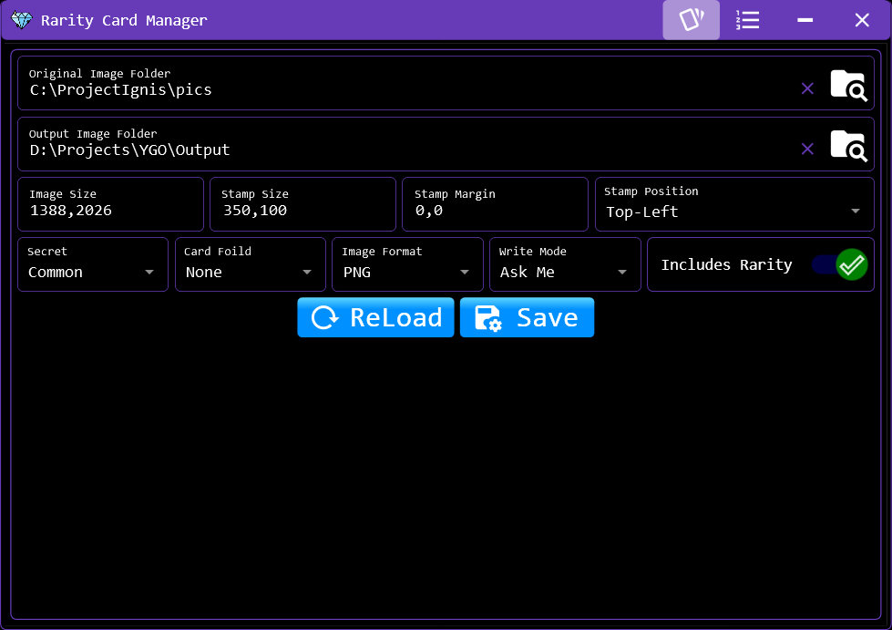
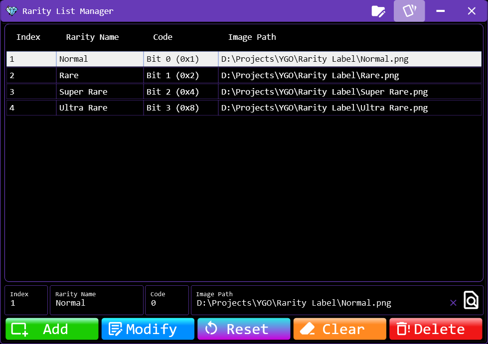
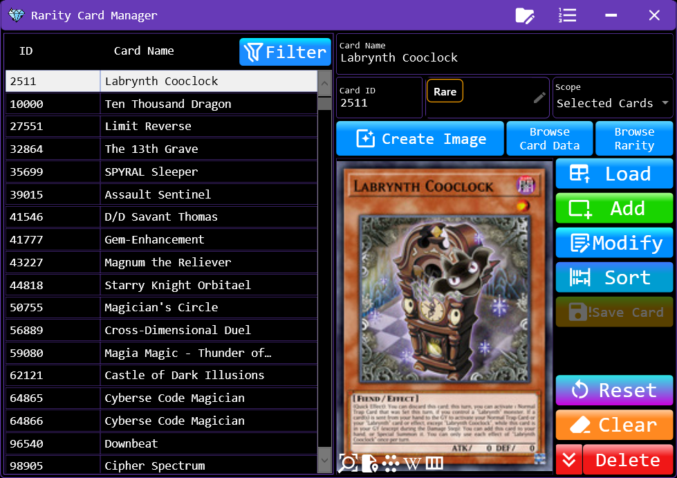

# Rarity Manager

The Rarity Manager allows users to manage rarity definitions, assign rarities to cards, and generate card images with Rarity Labels.

The interface consists of three main sections:

Configuration Panel (Left): Configure image folders and other settings used by the image generation process.

Rarity Card Manager (Center): Manage the list of cards and their associated rarity data.

Rarity List Manager (Right): Define and manage rarity information, including rarity names, codes, and label images.

## Configuration

The Configuration Panel contains settings used by the Rarity Manager and its image generation features.

**Folder Path:**

- Original Image Folder: Specifies the folder containing the original card images used by the Create Image feature.

- Output Image Folder: Specifies the destination folder for the generated card images.

**Image Settings:**

- Other configuration options may be available depending on the current settings.

>Note: Turn On Includes Rarity if you want the Create Image feature to overlay Rarity Labels onto the generated card images.

## Rarity List Manager

The Rarity List Manager defines the rarities available for assignment to cards.

Each rarity entry contains the following fields:

### Rarity List Fields

|  Field            |  Description                         |
|-------------------|--------------------------------------|
| Index             | The ordering index of the rarity. Any integer value may be used, provided that it is unique within the list. Starting from `1` is recommended. |
| Rarity Name       | The display name of the rarity. Any name may be used. |
| Code              | The zero-based bit position assigned to the rarity. The first bit position MUST is `0`. The corresponding bit flag value is calculated as 2code. |
| Image Path        | The path to the image file used as the Rarity Label. This field is optional. If no image is specified, the *Create Image* feature will not draw a Rarity Label for that rarity. |

### Understanding Rarity Codes

The `code` field represents a zero-based bit position, not the bit flag value itself. Each rarity is assigned a distinct bit position, allowing multiple rarities to be combined using bitwise operations.

The corresponding bit flag value is calculated using:

Bit Flag Value = 2Code

For example:

| Rarity Name   | Code  |    Binary Flag    | Decimal Value           |
|---------------|------:|------------------:|------------------------:|
| Normal        | `0`   | `1` (`01`)        | (20 = 1)     |
| Rare          | `1`   | `10` (`10`)       | (21 = 2)     |
| Super Rare    | `2`   | `100` (`100`)     | (22 = 4)     |
| Ultra Rare    | `3`   | `1000` (`1000`)   | (23 = 8)     |
| Secret Rare   | `4`   | `10000` (`10000`) | (24 = 16)    |

>Important: Each rarity must use a distinct bit position. Do not use the decimal bit flag value as the `Code`; enter the zero-based bit position instead.

For detailed instructions on the Rarity List Database structure, refer to [Rarity List Structure](../../../Structure/English/RarityListStructure.md).

#### Rarity Label

A Rarity Label is an image overlaid onto a card image to represent its rarity. Its appearance and placement depend on the configured label image and the relevant image settings.

If a rarity has no associated image, the card can still be listed and managed, but no Rarity Label will be drawn for that rarity during image generation.

## Rarity Card Manager

The Rarity Card Manager manages the rarity data associated with individual cards.

The data is stored in the Rarity Card Database. The manager provides operations for loading, editing, filtering, sorting, importing, and saving card rarity data.

1. Data Management

- Load: Loads Rarity Card data from the database and displays it in the View.
- Add: Adds a new Rarity Card entry to the View and immediately saves that item to the database.
- Modify: Edits an existing Rarity Card entry in the View and immediately saves the modified item to the database.
- Save: Saves the entire list in the View to the database. This operation is required after importing data through either of the Browse features.
- Reset: Restores the selected Rarity Card's displayed data to its original state.
- Clear: Clears the data currently displayed in the View.

>Note: The Add and Modify operations save their respective items immediately. In contrast, data imported through the Browse features is not saved automatically.

2. Sorting and Filtering

- Sort: Sorts the Rarity Card list according to the sorting order configured in Settings.
- Filter/Search: Filters the Rarity Card list displayed in the View based on the specified search criteria.

Filtering affects which entries are displayed and can be used to narrow the list before performing operations such as Delete Found Card.

3. Deleting Rarity Cards

The Rarity Card Manager provides four deletion operations with different scopes.

|  Operation            |          Description            |
|-----------------------|---------------------------------|
| Delete                | Deletes the currently selected item. If multiple items are selected, only the last selected item is deleted.
| Delete Selected Card  | Deletes all items currently selected in the Rarity Card list.
| Delete Found Card     | Deletes all items currently displayed in the list after the active filtering or search conditions have been applied.
| Delete All Card       | Deletes all Rarity Card entries, regardless of the current filtering or search conditions.

>Warning: These operations can remove multiple entries at once. Pay particular attention to the deletion scope, especially when using Delete Found Card or Delete All Card.

4. Browse Card Data

Select a Card List file to import card data into the View.

Supported file formats:

- Card Database (SQLite): `*.cdb`, `*.db`, `*.bytes`, `*.sqlite`
- Excel: `*.xlsx`, `*.xlsm`, `*.xltx`, `*.xltm`
- Text: `*.ceds`, `*.json`, `*.txt`

The imported data depends on the selected file type:

- Card List (`SQLite`, `Excel`, `JSON`): Import only the Card ID and Card Name for each card. The card rarity is set to 0.
- Rarity Card List (`.cdb`): Imports the Card ID, Card Name, and Card Rarity of each card.

For the file structures, refer to:

- [View Card List Structure](../../../Structure/English/CardListStructure.md)
- [View Rarity Card List Structure](../../../Structure/English/RarityCardStructure.md)

>Note: After browsing a Card List, use Browse Rarity to import the corresponding Rarity data.

5. Browse Rarity

Select a JSON file containing a list of Rarity data to import into the View.

Each entry must contain the following fields:

- Card ID
- Card Name
- Card Rarity

After reviewing the imported data, click Save to save the entire list currently displayed in the View to the Rarity Card Database.

>Important: The Browse operations only update the View. They do not save imported entries to the database automatically.

6. Creating Card Images

The Create Image feature generates card images using the original card artwork, Rarity Card data, and rarity configuration.

For each Rarity Card entry, the feature:

- Locates the corresponding original card image in the Original Image Folder.
- Loads the original image and processes it according to the configured image settings.
- Overlays the corresponding Rarity Label at the configured position when rarity labels are enabled and an image is available.
- Saves the generated image to the Output Image Folder.

The resulting images can be used wherever rarity-specific card artwork is required by the project.

>Note: The generated image depends on the availability of the original card image, the associated rarity data, the Rarity Label image, and the relevant configuration settings.

---

[← Previous: DeckEditor](../Windows/DeckEditor.md)&nbsp;&nbsp;&nbsp;||&nbsp;&nbsp;&nbsp;[Next: Genesys Manager →](../Manager/GenesysManager.md)

[← Getting Started](../GettingStarted.md)