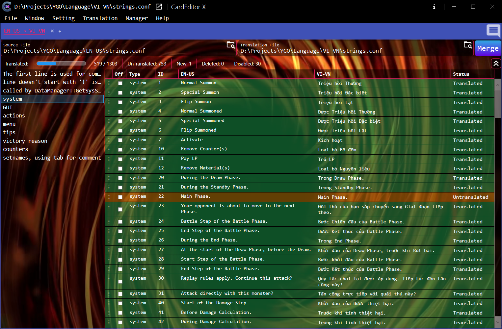

# Strings Config Editor

Strings Config Editor is designed to help users manage, compare, and maintain consistency across strings files in the game.

When the game is updated, the original strings file may be modified by the developers. To keep translations synchronized with the latest game version, users can use the Strings Config Editor to compare the updated source file with the existing strings file.

This editor helps identify new, existing, and removed string entries, making it easier to maintain and update string file without manually checking thousands of lines.

## Overview



The Strings Config Editor provides a tabular interface for viewing, comparing, and editing translation entries stored in Strings.conf files.

Each language has its own Strings.conf file. The editor uses a source file (typically EN-US) as the reference and compares it with the corresponding translated file to identify translation entries that need attention.

## 1. File Format

The Strings.conf file consists of individual lines, with each line following this format:

```conf
![type] [ID] [Content]
```

For easier management, string entries are organized into Sections. Each Section begins with a line starting with the # character. All valid entries following that header belong to that Section until another Section header is encountered.

Example:

```conf
!system 1 Normal Summon
!system 2 Special Summon
!system 3 Flip Summon
!system 4 Normal Summoned
#!system 5 Special Summoned
!system 6 Flip Summoned
!system 7 Activate
!system 10 Remove Counter(s)
#!system 11 Pay LP
!system 12 Remove Material(s)
!system 20 During the Draw Phase.
!system 21 During the Standby Phase.
```

Entries beginning with the # character will be treated as disabled.

## 2. Data Loading and Comparison

When loading string data, the editor reads both the Source File and the corresponding Translation File.

### Entry Recognition

Each line is evaluated to determine whether it represents a valid entry, a disabled entry, a Section header, or an invalid line.

The following formats are recognized:

| Format                    | Description        |
|---------------------------|--------------------|
| ![type] [ID] [Content]    | A valid enabled entry.|
| #![type] [Any Text]       | A valid disabled entry.|
| #[type] [Any Text]        | A valid disabled entry.|
| #[Any Text]               | A Section header.|

A string is recognized as a valid `[type]` if it has previously appeared as the type of another valid entry.

Lines that do not match any of the supported formats are considered invalid and ignored.

Note: Entries beginning with # are not necessarily Section headers. Depending on their format and content, they may represent disabled entries.

### Data Parsing and Merging

The editor processes both files and extracts the following information from each valid entry:

- Type: The entry type.
- ID: The entry identifier.
- Content: The text associated with the entry.
- Enabled: Whether the entry is enabled or disabled.

Entries from both files are matched using the combination of [Type] and [ID] as the matching key.

After matching, the editor displays the merged data in separate DataGrid columns:

- Disabled: The CheckBox enabled/disabled state from the Source File, Checked -> Disabled
- Type: The entry type.
- ID: The entry identifier.
- Source Content: The Content from the Source File.
- Translation Content: The Content from the Translation File.
- Status: The translation status of the entry.

This approach preserves existing translations while allowing users to compare source and translated content side by side and identify entries that require attention.

## 3. Editor Layout

The editor interface consists of two main areas:

- Section List (Left Panel): Displays all Sections found in the string data. Selecting a Section displays its corresponding entries in the DataGrid.
- Strings DataGrid (Right Panel): Displays the string entries belonging to the selected Section.

The DataGrid contains the following columns:

| Column                |    Description     |
|-----------------------|--------------------|
| Enabled               | A CheckBox indicating whether the entry is enabled or disabled. Editable.|
| Type                  | Displays the type of the string entry (e.g., system, card, etc.). Read-only. |
| ID                    | Displays the unique identifier for the string entry. Read-only. |
| Source Content        | The original content retrieved from the Source File. Read-only. |
| Translation Content   | The translated content retrieved from the Translation File. Editable.|
| Status                | Indicates the current state of the translation entry. Each status is represented by a specific color.|

## 4. String Status

Each string entry is assigned one of the following statuses:

| Status        | Color    | Description       |
|---------------|----------|-------------------|
| Translated    | Green    | The entry has an existing translation and does not require further action.|
| UnTranslated  | Orange   | The entry does not have a translation and needs to be translated.|
| Deleted       | Red      | The entry exists in the Strings File but is no longer present in the Source File.|
| New           | Blue     | The entry has been newly added to the Source File and requires translation.|

**Important: Green entries (Translated) are considered complete. All entries displayed in other colors require attention and should be reviewed or processed accordingly.**

## 5. Saving Files

By default, the editor saves the current content to the Translation File. The Source File is used for reference only and will not be modified.

To save the translation content as a new file, use Save As (Menu File -> Save As or Ctrl + Shift + S).

---

[Translation Config Editor →](../Translations/TranslationConf.md)

Next:

[Rarity Manager →](../Manager/RarityManager.md)

[Genesys Manager →](../Manager/GenesysManager.md)

Previous:

[← DeckEditor](../Windows/DeckEditor.md)

[← Getting Started](../GettingStarted.md)
