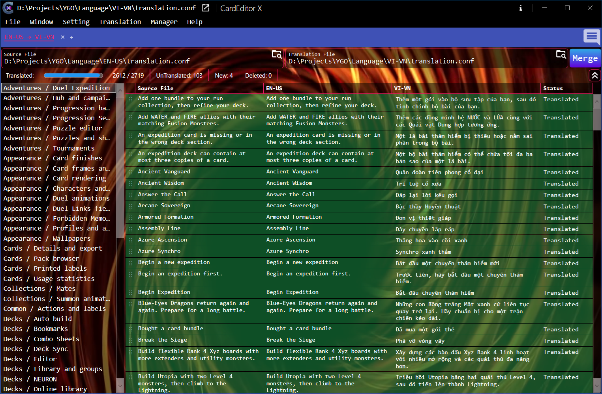

# Translation Config Editor

Translation Config Editor is designed to help users manage, compare, and maintain consistency across translation files in the game.

When the game is updated, the original translation file may be modified by the developers. To keep translations synchronized with the latest game version, users can use the Translation Config Editor to compare the updated source file with the existing translated file.

This editor helps identify new, existing, and removed translation entries, making it easier to maintain and update translations file without manually checking thousands of lines.

## Overview



The Translation Config Editor provides a tabular interface for viewing, comparing, and editing translation entries stored in Translation.conf files.

Each language has its own Translation.conf file. The editor uses a source file (typically EN-US) as the reference and compares it with the corresponding translated file to identify translation entries that need attention.

## 1. File Format

The Translation.conf file consists of individual lines, with each line following this format:

```conf
[Original Content]->[Translated Content]
```

For easier management, translation entries are organized into Sections. Each Section begins with a line starting with the # character. All valid entries following that header belong to that Section until another Section header is encountered.

Example:

```conf

# Adventures / Duel Expedition
Add one bundle to your run collection, then refine your deck.->Add one bundle to your run collection, then refine your deck.
Add WATER and FIRE allies with their matching Fusion Monsters.->Add WATER and FIRE allies with their matching Fusion Monsters.

# Adventures / Hub and campaigns
Adventure content is missing.->Adventure content is missing.
All Solo Gates are now completed.->All Solo Gates are now completed.

```

## 2. Data Loading and Comparison

When loading translation data, the editor reads both the Source File and the corresponding Translation File line by line.

Each valid entry is split into two parts using the -> delimiter:

- **Left side**: Original Content, used as the key to match entries between the two files.

- **Right side**: The content associated with the Original Content, which is used as either Source Content or Translation Content depending on the file.

The editor extracts data from each file as follows:

- Source File:

  - Original Content: The text on the left side of the -> delimiter.
  - Source Content: The text on the right side of the -> delimiter.

- Translation File:

  - Translation Content: The text on the right side of the -> delimiter.

The editor then merges the extracted data by matching entries based on their Original Content.

This allows existing translations to be retained while displaying the latest source content and identifying entries that have been added, modified, or removed.

## 3. Editor Layout

The editor interface consists of two main areas:

- Section List (Left Panel): Displays all Sections found in the translation data. Selecting a Section displays its corresponding entries in the DataGrid.
- Translation DataGrid (Right Panel): Displays the translation entries belonging to the selected Section.

The DataGrid contains the following columns:

| Column             |    Description     |
|--------------------|--------------------|
| Original Content   | The key used to match entries between the Source File and Translation File. Read-only.|
| Source Content     | The original text provided by the developers in the Source File. Read-only.|
| Translation Content| The translated text retrieved from the Translation File. Editable.|
| Status             | Indicates the current state of each translation entry. Each status is represented by a specific color.|

## 4. Translation Status

Each translation entry is assigned one of the following statuses:

| Status        | Color    | Description       |
|---------------|----------|-------------------|
| Translated    | Green    | The entry has an existing translation and does not require further action.|
| UnTranslated  | Orange   | The entry does not have a translation and needs to be translated.|
| Deleted       | Red      | The entry exists in the Translation File but is no longer present in the Source File.|
| New           | Blue     | The entry has been newly added to the Source File and requires translation.|

**Important: Green entries (Translated) are considered complete. All entries displayed in other colors require attention and should be reviewed or processed accordingly.**

## 5. Saving Files

By default, the editor saves the current content to the Translation File. The Source File is used for reference only and will not be modified.

To save the translation content as a new file, use Save As (Menu File -> Save As or Ctrl + Shift + S).

---

[Strings Config Editor →](../Translations/StringsConf.md)

Next:

[Rarity Manager →](../Manager/RarityManager.md)

[Genesys Manager →](../Manager/GenesysManager.md)

Previous:

[← DeckEditor](../Windows/DeckEditor.md)

[← Getting Started](../GettingStarted.md)
