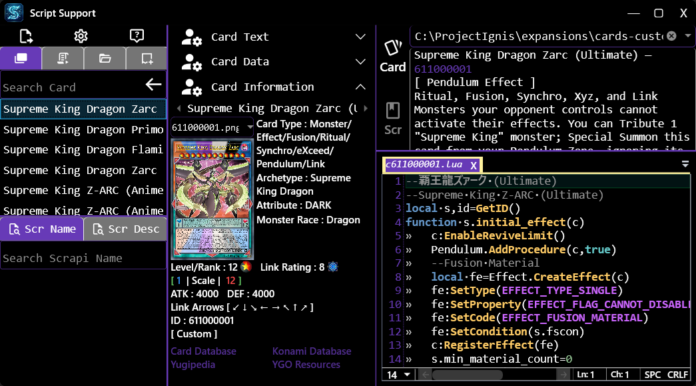

# Script Support

Script Support is a reference library designed to help users access and explore Card Information, Card Scripts, Scrapi Books, and other resources related to the Yu-Gi-Oh! Card Game Engine.

## Overview

Script Support supports two operating modes:

- Standalone Mode: Run Script Support as an independent application.
- Embedded Mode: Access Script Support as an integrated module within CardEditorX.

Both modes provide access to the same reference resources and functionality, allowing users to choose the operating environment that best fits their workflow.

---

[← Previous: CodeEditor](./CodeEditor.md)

[← Getting Started](../GettingStarted.md)
