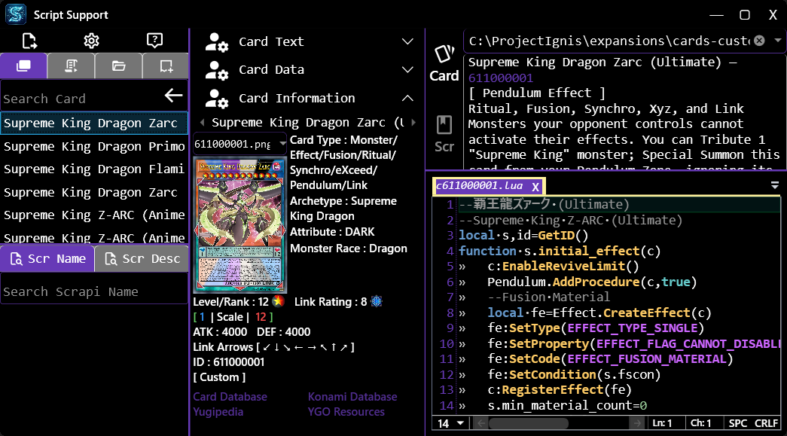

# Interface Overview

The Script Support interface is organized into three main areas:
the **Navigation Panel**, the **Result Panel**, and the **Advanced Panel**.
Each area provides access to different resources and functionalities, allowing users to search, browse, and explore Card Information, Card Scripts, and Scrapi Books within a unified workspace.

## A. Navigation Panel

The Navigation Panel is located on the left side of the interface and consists of three sections arranged vertically.

### I. Menu

The top section contains the application menu, providing access to general commands and application functions.

### II. Card and File Navigation

The middle section contains a Tab Control with four tabs: **Card**, **Script**, **Open**, and **New**.

#### 1. Card

This tab provides functionality for searching Card Descriptions.

- **Search Card Desc:** Enter a search string to find Cards whose descriptions contain the specified text in the configured DataSource.
- **Advanced Search:** Click the arrow button on the right side of the search box to open the Advanced Panel.
- **Search Results:** Displays the Cards matching the search criteria.

#### 2. Script

This tab provides functionality for searching Card Scripts.

- **Search Script:** Enter a search string to find Cards whose scripts contain the specified text in the configured DataSource.
- **Advanced Search:** Click the arrow button on the right side of the search box to open the Advanced Panel.
- **Search Results:** Displays the Cards whose scripts match the search criteria.

#### 3. Open

Displays the list of existing text files opened through the **Open** command in the application menu.

#### 4. New

Displays the list of new text files created through the **New** command in the application menu.

#### Opening Items from Search Results

Items in the search results can be opened using either of the following interactions:

- **Single Click:** Opens the selected item's content in a Temporary Tab.
- **Double Click:** Opens the selected item's content in a Permanent Tab.

The behavior of Temporary and Permanent Tabs is described in the [Script Editor Reference](../Reference/ScriptEditorReference.md) documentation.

### III. Scrapi Books

The bottom section contains a Tab Control dedicated to browsing Scrapi Books.

YGO OCG-Core provides its own collection of Functions, Constants, Namespaces, Enums, Tags, and Types. To simplify references throughout this documentation, these elements are collectively referred to as **Scrapi**.

The Scrapi Books section contains two tabs:

#### 1. Scr Name

Provides functionality for searching Scrapi by name.

- **Search Name:** Enter a search string to search for Scrapi names.
- **Search Results:** Displays the Scrapi items matching the search criteria.

#### 2. Scr Desc

Provides functionality for searching Scrapi by description.

- **Search Desc:** Enter a search string to search for Scrapi descriptions.
- **Search Results:** Displays the Scrapi items matching the search criteria.

#### Opening a Scrapi Item

When a Scrapi item is selected from the search results, its documentation is displayed in the **Scrapi Result** area of the Result Panel.

If **Auto Search** is enabled under `Settings → Configuration → Data Handling → Auto Search`, Script Support automatically searches for Card Scripts that use the selected Scrapi item.

This allows users to explore both the API documentation and its practical usage in existing Card Scripts.

## B. Result Panel

The Result Panel is located on the right side of the interface and consists of two sections arranged vertically.

### I. Result Browser

The upper section contains a Tab Control with two tabs: **Desc Result** and **Scrapi Result**.

#### 1. Desc Result

Displays the Card Description of the currently selected Card, if available.

Script Support supports multiple Card Description versions for the same Card ID. When multiple versions are available, a ComboBox above the result area allows users to select the version they want to view.

#### 2. Scrapi Result

Displays the documentation of the currently selected Scrapi item.

### II. Script Result

The lower section displays Card Scripts in a Tab-based interface.

Each opened Card Script is displayed in its own Tab, allowing users to switch between multiple scripts within the same workspace.

#### Tab Organization

Script Support supports drag-and-drop Tab operations, allowing users to:

- Reorder Tabs.
- Tear off Tabs.
- Merge Tabs into another Tab Control.

These operations provide flexibility when organizing multiple Card Scripts within the workspace.

## C. Advanced Panel

The Advanced Panel provides additional search and information capabilities for Card lookup.

It can be opened by clicking the arrow button on the right side of the search box in the **Card** tab.

The panel contains three Expanders:

### I. Card Text

Provides text-based search functionality for Cards.

Searchable fields include:

- Card ID
- Card Alias
- Card Name.
- Card Description.
- Card String.

### II. Card Data

Provides search functionality based on Card attributes and properties.

Available search criteria include:

- Scope.
- Type.
- Race.
- Attribute.
- Other available Card properties.

### III. Card Information

Displays detailed information about the currently selected Card.

Depending on the available data, this section may include:

- Card Name.
- Card Type.
- Card Image.
- Other Card-related information.

---

Next: [Card →](../Reference/CardReference.md)

Previous:

[←  Configuration](../Settings/Configuration.md)

[← Getting Started](../GettingStarted.md)
