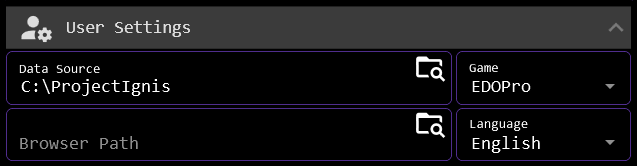
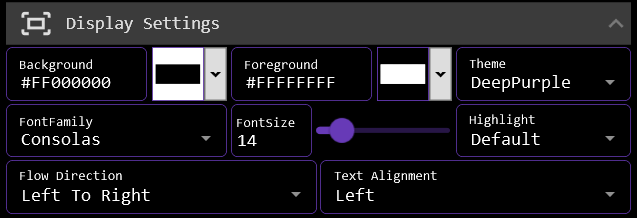
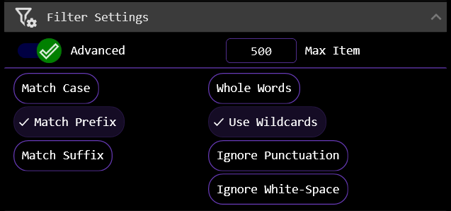
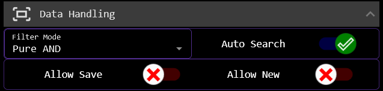
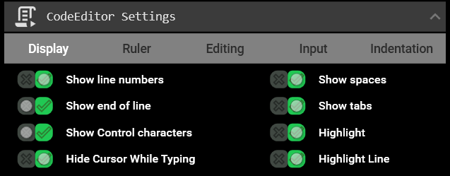

# Configuration

This document describes the configuration options available in ScriptSupport.

To open the Configuration window, select **Settings** → **Configuration** from the main menu, or press `Alt` + `S`.

Configuration settings are organized into several sections based on their purpose. Changes made in the Settings window are applied to the corresponding application components.

<strong><big>&nbsp;&nbsp;User Settings</big></strong>

 

The User Settings section allows users to configure the basic information and data sources required by the App.

### Data Source

Script Support uses the Data Source directory as the root source for card data and related resources, including:

- Card data
- Scripts
- Images

The selected directory should be the root folder of your data source. In most cases, this should be the parent folder of game folder.

The Application can still run without a configured Data Source. However, most features that rely on data lookup, search, or resource discovery will not work correctly.

To set the path, you can use one of the following methods:
- Click the "Browse" button (at the top-right of the input field) and navigate to the target folder.
- Use the "Copy as path" option for the target folder and press Ctrl + V in the input field.
- Drag and drop the target folder directly into the input field to obtain the path.

Note: Avoid selecting a data source folder that is excessively large or contains a large amount of irrelevant data. The larger the data source, the longer it will take for the application to scan and index the content within it.

### Language

The Language setting determines the language used to display the App interface and content.

To change the language:
1. Open User Settings
2. Select the desired Language from the Language dropdown list
3. Click the Save button

Available languages: English, Vietnamese, Japanese.

To add a new language:
1. Copy the English folder located at `ScriptSupport/data/CardData/Language/`
2. Paste the copied folder into the same Language directory
3. Rename the copied folder to the name of the new language
4. Translate the contents of the files inside the new folder into your language.
5. Reopen to the Configuration window and select the newly added language.

- Note: You do not need to restart the App. The App is designed to allow all configuration settings to be changed while it is running.

### Game

This setting only determines the display Source for Data Realization from the Card Database.
It does not affect the underlying data-processing logic or database operations.

If this setting is not configured, CardEditorX can still perform its normal database operations, but features that rely on Data Realization may not display the expected game-related information.

<strong><big>&nbsp;&nbsp;Display Settings</big></strong>

 

Display Settings controls the appearance and text layout of ScriptSupport.

### Colors

- Background Color — Sets the background color used by the application.
- Foreground Color — Sets the default foreground (text) color.
- Theme Color — Sets the colors used for headers, borders, and selection effects in the user interface.

### Font

- Font Family — Selects the font family used by the application.
- Font Size — Sets the default font size.
- Highlight — Configures the syntax highlighting colors used by the Code Editor.

### Text Layout

- Flow Direction — Controls the direction in which text and user interface content flows.
- Text Alignment — Controls the alignment of text within supported controls.

Note: Some display settings may apply only to specific user interface elements or editors.

<strong><big>&nbsp;&nbsp;Filter Settings</big></strong>

 

Filter Settings control the number of search results returned by the application and provide additional options for customizing text matching behavior.

### 1. Maximum Items

Specifies the maximum number of items returned in a single search operation.

For example, assume the Data Source contains approximately 15,000 Cards, and a search query matches 2,000 of them.

If Maximum Items is set to 500, the application returns only the first 500 matching items instead of displaying all 2,000 results.

This limitation helps reduce processing time and improve application performance, especially when searching through large Data Sources.

### 2. Advanced Filter

Advanced Filter provides additional options for controlling how search queries are matched against the target text.

| Option                | Description        |
|-----------------------|--------------------|
| Match Case            | Considers uppercase and lowercase characters as different when matching text.|
| Match Prefix          | Matches text that starts with the specified search term.|
| Match Suffix          | Matches text that ends with the specified search term.|
| Whole Word            | Matches the search term as a complete word rather than as part of another word.|
| Use Wildcards         | Enables wildcard characters in search queries.|
| Ignore Punctuation    | Ignores punctuation characters when comparing text.|
| Ignore White-Space    | Ignores whitespace characters when comparing text.|

These options allow users to customize search behavior according to their requirements.

<strong><big>&nbsp;&nbsp;Data Handling</big></strong>

 

### Filter Mode

Filter Mode determines how multiple filter conditions are combined during filtering.

|Mode|Description|
|:---|:---|
|Pure AND|A card must satisfy all filter conditions|
|Pure OR|A card only needs to satisfy one or more filter conditions|
|Mixed AND-OR|Applies AND between groups and OR within each group|
|Mixed OR-AND|Applies OR between groups and AND within each group|

For example, given two filter groups:

- Group A: Condition 1 + Condition 2
- Group B: Condition 3 + Condition 4

With Mixed AND-OR, a card must satisfy => (Condition 1 OR Condition 2) AND (Condition 3 OR Condition 4)

With Mixed OR-AND, the groups are combined => (Condition 1 AND Condition 2) OR (Condition 3 AND Condition 4)

### Auto Search

When enabled, selecting a Scrapi entry automatically searches the contents of the available Lua script files for the selected Scrapi name.

Matching scripts are displayed in the Script Result area.

This feature performs a text-based search and does not analyze Lua syntax to determine whether the Scrapi component is actually being used.

### Allow Save

Allow Save determines whether users can save changes made to the content currently displayed in the Script Editor back to the original file.

Enabled: Users can save modified content to the original file.

Disabled: Users can still view and modify content in the Script Editor, but cannot save those changes to the original file.

This option helps prevent accidental modifications to existing game files.

### Allow New

Allow New determines whether users can create new text files through the application.

Enabled: Users can create new text files.

Disabled: Users cannot create new text files through the application.

Since Lua script files are also text files, this option also controls the creation of new Script files.

Note: Allow Save and Allow New are independent settings. Disabling one does not affect the functionality controlled by the other.

<strong><big>&nbsp;&nbsp;CodeEditor Settings</big></strong>

 

These settings control the editing experience when writing and editing scripts.

These options customize the editor's appearance, text layout, input behavior, navigation, indentation, word wrapping, code folding, and other editing preferences.

---

Next: [Interface Overview →](../Interface/InterfaceOverview.md)

Previous: [← Getting Started](../GettingStarted.md)