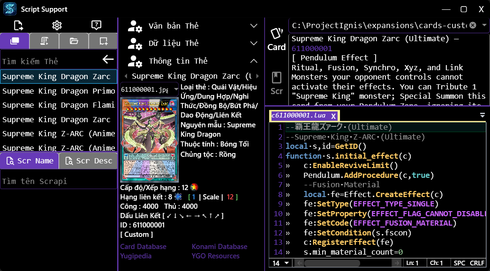

# インターフェースの概要

Script Support のインターフェースは、主に 3 つの領域で構成されています。
**ナビゲーションパネル**、**Result Panel**、および **高度な検索パネル** です。
各領域は、それぞれ異なるリソースや機能へのアクセスを提供します。これにより、ユーザーは同じ作業スペース内で、カード、カードスクリプト、Scrapi Books の情報を検索、閲覧、参照できます。

## A. ナビゲーションパネル

ナビゲーションパネルはインターフェースの左側に配置され、縦方向に並んだ 3 つの領域で構成されています。

### I. メニュー

最上部の領域にはアプリケーションのメニューが配置され、共通コマンドやアプリケーションの各機能にアクセスできます。

### II. カードとファイルのナビゲーション

中央の領域には、**カード**、**スクリプト**、**開く**、**新規** の 4 つの Tab を持つ Tab Control が配置されています。

#### 1. カード

この Tab では、カードの説明内容を検索できます。

- **カード検索:** 検索キーワードを入力すると、設定済みの Data Source 内から、説明に該当する内容を含むカードを検索します。
- **高度な検索:** 検索フィールドの右側にある矢印ボタンをクリックすると、高度な検索パネルが開きます。
- **検索結果:** 検索条件に一致するカードの一覧を表示します。

#### 2. スクリプト

この Tab では、カードスクリプトを検索できます。

- **スクリプト検索:** 検索キーワードを入力すると、設定済みの Data Source 内から、スクリプトに該当する内容を含むカードを検索します。
- **高度な検索:** 検索フィールドの右側にある矢印ボタンをクリックすると、高度な検索パネルが開きます。
- **検索結果:** 検索条件に一致するスクリプトを持つカードの一覧を表示します。

#### 3. 開く

アプリケーションメニューの **開く** コマンドを使用して開いた、既存のテキストファイルの一覧を表示します。

#### 4. 新規

アプリケーションメニューの **新規** コマンドを使用して作成した、新しいテキストファイルの一覧を表示します。

#### 検索結果から Item を開く

検索結果内の Item は、次のいずれかの操作で開くことができます。

- **左クリック:** 選択したカードのスクリプト内容を一時 Tab で開きます。
- **左ダブルクリック:** 選択したカードのスクリプト内容を固定 Tab で開きます。

一時 Tab と固定 Tab の動作については、[Script Editor](../Reference/ScriptEditorReference.md) のドキュメントを参照してください。

### III. Scrapi Books

最下部の領域には、Scrapi Books の参照専用 Tab Control が配置されています。

YGO OCG-Core は、独自の Functions、Constants、Namespaces、Enums、Tags、Types を提供しています。このドキュメントでは、簡潔に説明するため、これらの要素を総称して **Scrapi** と呼びます。

Scrapi Books 領域には、次の 2 つの Tab があります。

#### 1. Scr Name

名前によって Scrapi を検索できます。

- **Scrapi の名前を検索:** キーワードを入力して Scrapi の名前を検索します。
- **Search Results:** 検索条件に一致する Scrapi の一覧を表示します。

#### 2. Scr Desc

説明によって Scrapi を検索できます。

- **Scrapi の説明を検索:** キーワードを入力して Scrapi の説明内容を検索します。
- **Search Results:** 検索条件に一致する Scrapi の一覧を表示します。

#### Scrapi を開く

検索結果から Scrapi を選択すると、その Item のドキュメントが Result Panel 内の **Scrapi Result** 領域に表示されます。

`設定 → 環境設定 → データ処理 → 自動検索` で **自動検索** が有効になっている場合、Script Support は選択中の Scrapi を使用しているカードスクリプトを自動的に検索します。

これにより、ユーザーは API ドキュメントを参照しながら、既存のカードスクリプト内で各要素がどのように使用されているかを確認できます。

## B. Result Panel

Result Panel はインターフェースの右側に配置され、縦方向に並んだ 2 つの領域で構成されています。

### I. Result Browser

上部の領域には、**Desc Result** と **Scrapi Result** の 2 つの Tab を持つ Tab Control が配置されています。

#### 1. Desc Result

現在選択されているカードの説明内容を表示します。説明データが存在する場合に表示されます。

Script Support は、同じ Card ID に対して複数の説明バージョンをサポートしています。複数のバージョンが存在する場合、表示領域の上部にある ComboBox から、表示するバージョンを選択できます。

#### 2. Scrapi Result

現在選択されている Scrapi Item のドキュメントを表示します。

### II. Script Result

下部の領域には、カードスクリプトが Tab インターフェースとして表示されます。

開いた各カードスクリプトは個別の Tab に表示されるため、同じ作業スペース内で複数のスクリプトを切り替えて編集できます。

#### Tab の配置

Script Support は Tab の Drag and Drop 操作をサポートしており、次の操作を行えます。

- Tab の順序を変更する。
- Tab を現在の Tab Control から切り離す。
- Tab を別の Tab Control に統合する。

これらの操作により、作業スペース内で複数のカードスクリプトを柔軟に整理・管理できます。

## C. 高度な検索パネル

高度な検索パネルでは、カード検索を補助する追加の検索機能を利用できます。

このパネルは、**カード** Tab の検索フィールド右側にある矢印ボタンをクリックすると開きます。

パネルには、次の 3 つの Expander が含まれています。

### I. カードテキスト

テキスト内容に基づいてカードを検索できます。

検索可能なフィールドは次のとおりです。

- Card ID
- カードの別名
- カード名
- カードの説明
- カードの文字列

### II. カードデータ

カードの属性や特性に基づいてカードを検索できます。

検索条件は次のとおりです。

- Scope
- Type
- Race
- Attribute
- その他のカード属性

### III. カード情報

現在選択されているカードの詳細情報を表示します。

利用可能なデータに応じて、次の情報が表示されます。

- カード名
- カードタイプ
- カード画像
- その他のカード情報

---

次へ: [Card Reference →](../Reference/CardReference.md)

前へ:

[← 設定](../Settings/Configuration.md)

[← はじめに](../GettingStarted.md)
