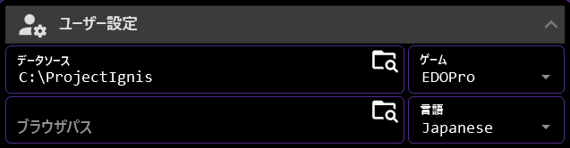
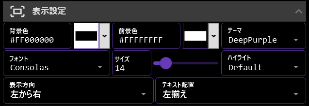
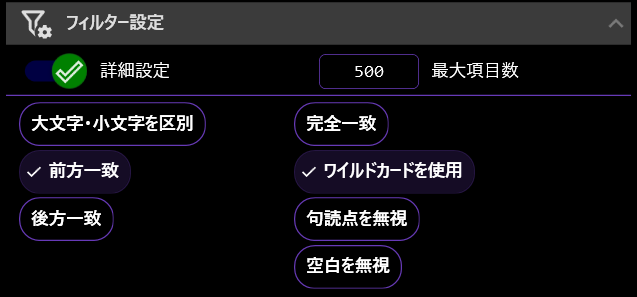
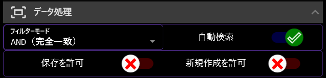
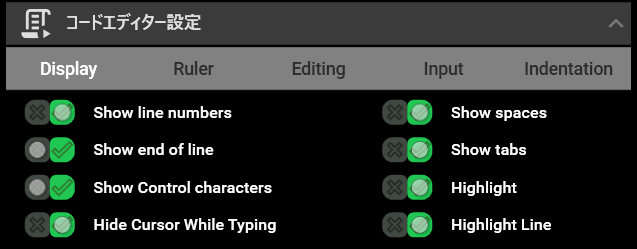

# 設定

このドキュメントでは、Script Support で利用可能な設定オプションについて説明します。

設定ウィンドウを開くには、メインメニューから **設定** → **Config** を選択するか、`Alt` + `S` を押してください。

設定項目は、それぞれの用途に応じて複数のセクションに分類されています。設定ウィンドウで行った変更は、アプリケーション内の対応するコンポーネントに適用されます。

<strong><big>&nbsp;&nbsp;ユーザー設定</big></strong>

 

ユーザー設定では、アプリケーションの基本情報および必要なデータソースを設定できます。

### データソース

Script Support は、カードデータおよび関連リソースの基本データソースとして、データソースフォルダーを使用します。これには以下が含まれます。

- カードデータ
- カードスクリプト
- カード画像

選択するフォルダーには、データソースのルートフォルダーを指定してください。通常は、ゲームフォルダーの親フォルダーを指定します。

データソースフォルダーが設定されていない場合、Scrapi を除く、データ参照に依存する機能は使用できません。

パスを設定するには、以下のいずれかの方法を使用できます。

- 入力欄の右上にある **「参照」** ボタンをクリックし、対象のフォルダーを選択します。
- 対象のフォルダーで **「Copy as path」** を選択し、入力欄で `Ctrl` + `V` を押します。
- 対象のフォルダーを入力欄に直接ドラッグ＆ドロップして、パスを取得します。

**注意:** 容量が大きすぎるフォルダーや、関連性のないデータを大量に含むフォルダーをデータソースとして指定することは避けてください。フォルダーのサイズが大きいほど、アプリケーションによる内容のスキャンおよびインデックス作成に時間がかかります。

### 言語

この設定では、アプリケーションのインターフェースおよびコンテンツの表示に使用する言語を指定します。

言語を変更するには:

1. ユーザー設定を開きます。
2. ドロップダウンリストから言語を選択します。
3. **保存** ボタンをクリックします。

現在、以下の言語が利用可能です。

- English
- Vietnamese
- Japanese

**新しい言語を追加するには:**

1. `ScriptSupport/data/CardData/Language/` にある English フォルダーをコピーします。
2. コピーしたフォルダーを同じ Language フォルダー内に貼り付けます。
3. コピーしたフォルダーの名前を、追加する言語の名前に変更します。
4. 新しいフォルダー内にある各ファイルの内容を、対応する言語に翻訳します。
5. Configuration ウィンドウを再度開き、追加した言語を選択します。

- 注意: アプリケーションを再起動する必要はありません。Script Support は、実行中でもすべての設定を変更できるように設計されています。

### ゲーム

この設定は、データベースから取得したデータの実体化に使用する表示元のみを指定します。
データ処理の内部ロジックやデータベース操作には影響しません。

この設定が構成されていない場合でも、アプリケーションは正常に動作します。ただし、データの実体化に依存する機能では、ゲームに関連する情報が期待どおりに表示されない場合があります。

<strong><big>&nbsp;&nbsp;表示設定</big></strong>

 

表示設定では、Script Support のユーザーインターフェースおよびテキストのレイアウトを制御します。

### 色

- **背景色** — アプリケーション全体で使用する背景色を設定します。
- **文字色** — アプリケーション全体で使用する標準の文字色を設定します。
- **テーマカラー** — ユーザーインターフェース内のタイトル、境界線、および選択時の視覚効果に使用する色を設定します。

### フォント

- **フォント** — アプリケーションで使用するフォントを設定します。
- **フォントサイズ** — 標準の文字サイズを設定します。
- **ハイライト** — コードエディターで使用するシンタックスハイライトの色を設定します。

### テキストレイアウト

- **表示方向** — テキストおよびユーザーインターフェースのコンテンツの表示方向を制御します。
- **テキストの配置** — 対応するコントロール内でのテキストの配置方法を制御します。

**注意:** 一部の表示設定は、特定のユーザーインターフェースコンポーネントまたは Editor にのみ適用されます。

<strong><big>&nbsp;&nbsp;フィルター設定</big></strong>

 

フィルター設定では、検索結果の最大件数を制御し、テキストデータの照合方法をカスタマイズするための追加オプションを提供します。

### 1. 最大項目数

1回の検索で返される項目の最大数を指定します。

**例:** データソースに約15,000件のカードが含まれており、ある検索クエリがそのうち2,000件のカードに一致したとします。

最大項目数が500に設定されている場合、アプリケーションは一致した2,000件すべてを表示するのではなく、最初の500件のみを検索結果として返します。

この制限により、処理時間を短縮し、特に大規模なデータソースを検索する際のパフォーマンスを向上させることができます。

### 2. 高度なフィルター

高度なフィルターでは、検索クエリと対象テキストの照合方法を制御するための追加オプションを提供します。

| オプション            | 説明             |
|---------------------|------------------|
| 大文字と小文字を区別   | テキストの照合時に大文字と小文字を区別します。 |
| 前方一致             | 検索キーワードで始まるテキストを検索します。 |
| 後方一致             | 検索キーワードで終わるテキストを検索します。 |
| 単語単位で一致        | 他の単語の一部ではなく、独立した単語として検索キーワードに一致するテキストを検索します。 |
| ワイルドカードを使用   | 検索クエリでワイルドカード文字を使用できるようにします。 |
| 句読点を無視          | テキストの比較時に句読点を無視します。 |
| 空白文字を無視        | テキストの比較時に空白文字を無視します。 |

これらのオプションを使用することで、ユーザーは用途に応じて検索動作をカスタマイズできます。

<strong><big>&nbsp;&nbsp;データ処理</big></strong>

 

### フィルターモード

フィルターモードは、データのフィルタリング時に複数の Filter 条件をどのように組み合わせるかを指定します。

| モード             | 説明      |
|-------------------|----------|
| AND のみ           | カードはすべての Filter 条件を満たす必要があります。 |
| OR のみ            | カードはいずれか1つ以上の Filter 条件を満たせば該当します。 |
| AND-OR の組み合わせ | グループ間には AND を適用し、各グループ内には OR を適用します。 |
| OR-AND の組み合わせ | グループ間には OR を適用し、各グループ内には AND を適用します。 |

**例:** 2つの Filter グループがある場合:

- グループ A: 条件 1 + 条件 2
- グループ B: 条件 3 + 条件 4

AND-OR の組み合わせでは、カードは次の式を満たす必要があります。

`(条件 1 OR 条件 2) AND (条件 3 OR 条件 4)`

OR-AND の組み合わせでは、各グループは次の式で結合されます。

`(条件 1 AND 条件 2) OR (条件 3 AND 条件 4)`

### 自動検索

このオプションを有効にすると、Scrapi 項目を選択した際に、その Scrapi の名前が既存の Lua Script File の内容から自動的に検索されます。

一致したスクリプトは **Script Result** に表示されます。

この機能はテキストベースの検索を行うものであり、Scrapi の要素が実際に使用されているかどうかを判定するために Lua の構文解析を行うものではありません。

### 保存を許可

このオプションは、Script Editor に現在表示されている内容への変更を元のファイルに保存できるかどうかを制御します。

**有効:** 編集した内容を元のファイルに保存できます。

**無効:** Script Editor で内容の閲覧および編集は引き続き可能ですが、変更内容を元のファイルに保存することはできません。

このオプションは、既存のゲームファイルが意図せず変更されることを防ぐためのものです。

### 新規作成を許可

このオプションは、アプリケーションを通じて新しいテキストファイルを作成できるかどうかを制御します。

**有効:** 新しいテキストファイルを作成できます。

**無効:** アプリケーションを通じて新しいテキストファイルを作成することはできません。

Lua Script File もテキストファイルであるため、このオプションは新しいスクリプトファイルの作成も制御します。

**注意:** 保存を許可と新規作成を許可は、それぞれ独立した設定です。一方を無効にしても、もう一方の設定によって制御される機能には影響しません。

<strong><big>&nbsp;&nbsp;コードエディター設定</big></strong>

 

これらの設定は、スクリプトの記述および編集時の操作環境を制御します。

これらのオプションでは、Editor の外観、テキストのレイアウト、入力動作、ナビゲーション、インデント、自動折り返し、コードの折りたたみ、およびその他の編集機能をカスタマイズできます。

---

次へ: [インターフェースの概要 →](../Interface/InterfaceOverview.md)

前へ: [← はじめに](../GettingStarted.md)
