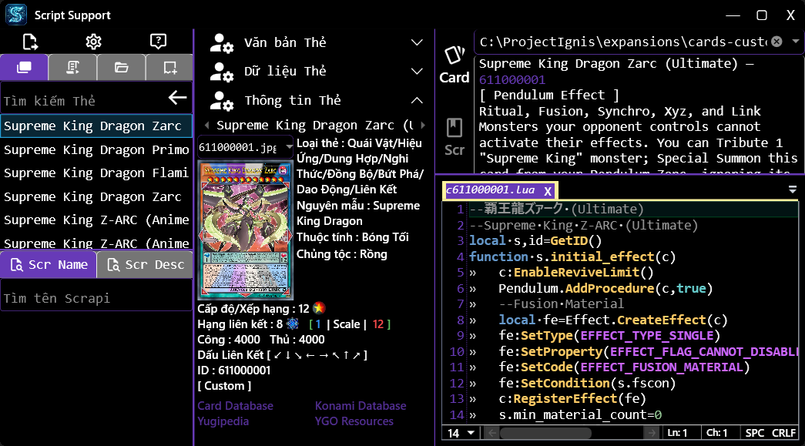

# Tổng quan Giao diện

Giao diện Script Support được chia thành ba khu vực chính:
**Bảng điều hướng**, **Bảng kết quả** và **Bảng Nâng Cao**.
Mỗi khu vực cung cấp quyền truy cập vào các tài nguyên và chức năng khác nhau, cho phép người dùng tìm kiếm, duyệt và khám phá thông tin Thẻ, Tập lệnh Thẻ và Scrapi Books trong cùng một không gian làm việc.

## A. Bảng điều hướng

Bảng điều hướng nằm ở phía bên trái giao diện và bao gồm ba khu vực được sắp xếp theo chiều dọc.

### I. Menu

Khu vực trên cùng chứa Menu của ứng dụng, cung cấp quyền truy cập vào các lệnh chung và chức năng của ứng dụng.

### II. Điều hướng Thẻ và Tệp

Khu vực ở giữa chứa một Tab Control với bốn Tab: **Thẻ**, **Tập Lệnh**, **Mở** và **Mới**.

#### 1. Thẻ

Tab này cung cấp chức năng tìm kiếm nội dung mô tả của Thẻ.

- **Tìm kiếm Thẻ:** Nhập từ khóa tìm kiếm để tìm các Thẻ có phần mô tả chứa nội dung tương ứng trong Nguồn Dữ Liệu đã được cấu hình.
- **Tìm Kiếm Nâng Cao:** Nhấn nút mũi tên ở phía bên phải ô tìm kiếm để mở Bảng Điều Khiển Nâng Cao.
- **Kết Quả Tìm Kiếm:** Hiển thị danh sách các Thẻ phù hợp với điều kiện tìm kiếm.

#### 2. Tập Lệnh

Tab này cung cấp chức năng tìm kiếm Tập Lệnh Thẻ.

- **Tìm kiếm Tập Lệnh:** Nhập từ khóa tìm kiếm để tìm các Card có Script chứa nội dung tương ứng trong Nguồn dữ liệu đã được cấu hình.
- **Tìm Kiếm Nâng Cao:** Nhấn nút mũi tên ở phía bên phải ô tìm kiếm để mở Bảng Nâng Cao.
- **Kết Quả Tìm Kiếm:** Hiển thị danh sách các Card có Script phù hợp với điều kiện tìm kiếm.

#### 3. Mở

Hiển thị danh sách các tệp văn bản hiện có được mở thông qua lệnh **Mở** trong Menu của ứng dụng.

#### 4. Mới

Hiển thị danh sách các tệp văn bản mới được tạo thông qua lệnh **Mới** trong Menu của ứng dụng.

#### Mở Item từ Kết quả Tìm Kiếm

Các Item trong kết quả tìm kiếm có thể được mở bằng một trong hai thao tác sau:

- **Nhấp đơn chuột trái:** Mở nội dung của Tập lệnh của Thẻ được chọn trong Tab Tạm Thời.
- **Nhấp đôi chuột trái:** Mở nội dung của Tập lệnh của Thẻ được chọn trong Tab Cố Định.

Cơ chế hoạt động của Tab Tạm Thời và Tab Cố Định được mô tả trong tài liệu [Trình Soạn Thảo Mã](../Reference/ScriptEditorReference.md).

### III. Scrapi Books

Khu vực dưới cùng chứa một Tab Control dành riêng cho việc tra cứu Scrapi Books.

YGO OCG-Core cung cấp một tập hợp các Functions, Constants, Namespaces, Enums, Tags và Types riêng. Để đơn giản hóa cách gọi trong toàn bộ tài liệu này, các thành phần trên được gọi chung là **Scrapi**.

Khu vực Scrapi Books bao gồm hai Tab:

#### 1. Scr Name

Cung cấp chức năng tìm kiếm Scrapi theo tên.

- **Tìm tên Scrapi:** Nhập từ khóa để tìm kiếm tên của các Scrapi.
- **Search Results:** Hiển thị danh sách các Scrapi phù hợp với điều kiện tìm kiếm.

#### 2. Scr Desc

Cung cấp chức năng tìm kiếm Scrapi theo mô tả.

- **Tìm mô tả Scrapi:** Nhập từ khóa để tìm kiếm nội dung mô tả của các Scrapi.
- **Search Results:** Hiển thị danh sách các Scrapi phù hợp với điều kiện tìm kiếm.

#### Mở một Scrapi

Khi một Scrapi được chọn từ kết quả tìm kiếm, tài liệu của Item đó sẽ được hiển thị trong khu vực **Scrapi Result** thuộc Result Panel.

Nếu **Tự động Tìm kiếm** được bật tại `Cài đặt → Cấu Hình → Xử lý Dữ liệu → Tự động Tìm Kiếm`, Script Support sẽ tự động tìm kiếm các Tập lệnh Thẻ có sử dụng Scrapi đang được chọn.

Điều này cho phép người dùng vừa tra cứu tài liệu API, vừa khám phá cách các thành phần đó được sử dụng trong những Tập lệnh Thẻ hiện có.

## B. Result Panel

Result Panel nằm ở phía bên phải giao diện và bao gồm hai khu vực được sắp xếp theo chiều dọc.

### I. Result Browser

Khu vực phía trên chứa một Tab Control với hai Tab: **Desc Result** và **Scrapi Result**.

#### 1. Desc Result

Hiển thị nội dung mô tả của Card đang được chọn, nếu có.

Script Support hỗ trợ nhiều phiên bản mô tả cho cùng một Card ID. Khi có nhiều phiên bản, một ComboBox phía trên khu vực hiển thị cho phép người dùng lựa chọn phiên bản muốn xem.

#### 2. Scrapi Result

Hiển thị tài liệu của Scrapi Item đang được chọn.

### II. Script Result

Khu vực phía dưới hiển thị các Card Script dưới dạng giao diện Tab.

Mỗi Card Script được mở sẽ được hiển thị trong một Tab riêng, cho phép người dùng chuyển đổi giữa nhiều Script trong cùng một không gian làm việc.

#### Sắp xếp Tab

Script Support hỗ trợ các thao tác kéo và thả (Drag and Drop) đối với Tab, cho phép người dùng:

- Thay đổi thứ tự các Tab.
- Tách Tab ra khỏi Tab Control hiện tại.
- Gộp Tab vào một Tab Control khác.

Các thao tác này mang lại sự linh hoạt trong việc tổ chức và quản lý nhiều Tập lệnh Thẻ trong không gian làm việc.

## C. Bảng Nâng Cao

Bảng Nâng Cao cung cấp các chức năng tìm kiếm và tra cứu thông tin bổ sung cho việc tìm kiếm Thẻ.

Bảng có thể được mở bằng cách nhấn nút mũi tên ở phía bên phải ô tìm kiếm trong Tab **Thẻ**.

Bảng bao gồm ba Bộ mở rộng:

### I. Văn bản Thẻ

Cung cấp chức năng tìm kiếm Thẻ dựa trên nội dung văn bản.

Các trường có thể tìm kiếm bao gồm:

- ID Thẻ
- Bí danh Thẻ
- Tên Thẻ
- Mô tả Thẻ
- Chuỗi Thẻ

### II. Dữ Liệu Thẻ

Cung cấp chức năng tìm kiếm dựa trên các thuộc tính và đặc điểm của Thẻ.

Các tiêu chí tìm kiếm bao gồm:

- Phạm vi
- Loại
- Chủng Tộc
- Thuộc Tính
- Các thuộc tính khác của Thẻ

### III. Thông tin Thẻ

Hiển thị thông tin chi tiết của Card đang được chọn.

Tùy thuộc vào dữ liệu hiện có, khu vực này có thể bao gồm:

- Tên Thẻ
- Loại Thẻ
- Hình ảnh Thẻ
- Các thông tin khác của Thẻ

---

Tiếp theo: [Thẻ Bài →](../Reference/CardReference.md)

Trước đó:

[← Cấu Hình](../Settings/Configuration.md)

[← Hướng Dẫn Bắt Đầu](../GettingStarted.md)
