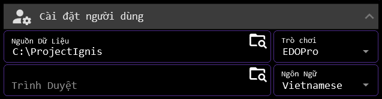
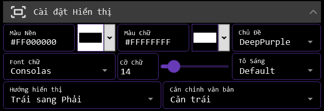
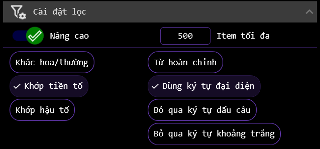
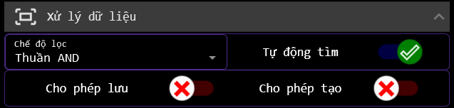
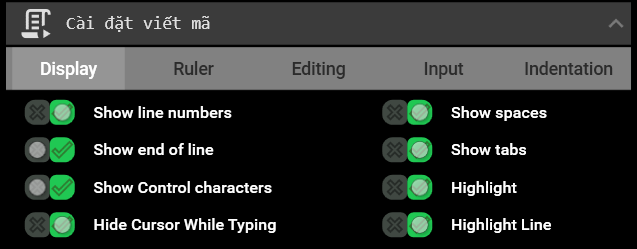

# Cấu Hình

Tài liệu này mô tả các tùy chọn cấu hình hiện có trong Script Support.

Để mở cửa sổ Cấu Hình, chọn **Cài Đặt** → **Cấu Hình** từ Menu chính hoặc nhấn `Alt` + `S`.

Các thiết lập Cấu Hình được tổ chức thành nhiều phần dựa trên mục đích sử dụng. Những thay đổi được thực hiện trong cửa sổ Cấu Hình sẽ được áp dụng cho các thành phần tương ứng của ứng dụng.

<strong><big>&nbsp;&nbsp;Cài Đặt Người Dùng</big></strong>

 

Cài Đặt Người Dùng cho phép cấu hình các thông tin cơ bản và Nguồn Dữ Liệu cần thiết cho ứng dụng.

### Nguồn Dữ Liệu

Script Support sử dụng thư mục Nguồn Dữ Liệu làm nguồn dữ liệu gốc cho Dữ Liệu Thẻ và các tài nguyên liên quan, bao gồm:

- Dữ Liệu THẻ
- Tập Lệnh Thẻ
- Hình Ảnh Thẻ

Thư mục được chọn nên là thư mục gốc của Nguồn Dữ Liệu. Trong hầu hết trường hợp, đây nên là thư mục cha của Thư Mục Trò Chơi.

Nếu không thiết lập Thư Mục Nguồn Dữ Liệu, các tính năng phụ thuộc vào việc tra cứu dữ liệu, ngoại trừ Scrapi, sẽ không hoạt động.

Để thiết lập đường dẫn, người dùng có thể sử dụng một trong các phương pháp sau:

- Nhấn nút "Duyệt" (ở góc trên bên phải của ô nhập liệu) và điều hướng đến thư mục cần chọn.
- Sử dụng tùy chọn "Copy as path" tại thư mục cần chọn, sau đó nhấn `Ctrl` + `V` trong ô nhập liệu.
- Kéo và thả trực tiếp thư mục cần chọn vào ô nhập liệu để lấy đường dẫn.

Lưu ý: Tránh chọn một thư mục Nguồn Dữ Liệu có dung lượng quá lớn hoặc chứa nhiều dữ liệu không liên quan. Thư mục càng lớn thì thời gian Ứng dụng cần để quét và lập chỉ mục nội dung bên trong càng lâu.

### Ngôn Ngữ

Thiết lập xác định ngôn ngữ được sử dụng để hiển thị giao diện và nội dung trong ứng dụng.

Để thay đổi ngôn ngữ:

1. Mở Cài Đặt Người Dùng.
2. Chọn Ngôn ngữ từ danh sách thả xuống.
3. Nhấn nút Lưu.

Các ngôn ngữ hiện có:

- English
- Vietnamese
- Japanese.

Để thêm một ngôn ngữ mới:

1. Copy thư mục English tại `ScriptSupport/data/CardData/Language/`.
2. Paste thư mục vừa Copy vào cùng thư mục Language.
3. Đổi tên thư mục vừa Copy thành tên của ngôn ngữ mới.
4. Dịch nội dung các File bên trong thư mục mới sang ngôn ngữ tương ứng.
5. Mở lại cửa sổ Configuration và chọn ngôn ngữ vừa được thêm.

- Lưu ý: Không cần khởi động lại ứng dụng. Ứng dụng được thiết kế cho phép thay đổi toàn bộ thiết lập Cấu Hình ngay cả khi đang hoạt động.

### Trò Chơi

Thiết lập này chỉ xác định Nguồn hiển thị cho Thực Hóa Dữ Liệu từ Cơ Sở Dữ Liệu.
Nó không ảnh hưởng đến Logic xử lý dữ liệu bên dưới hoặc các thao tác Cơ Sở Dữ Liệu.

Nếu thiết lập này chưa được cấu hình, Ứng dụng vẫn sẽ hoạt động bình thường. Tuy nhiên, những tính năng phụ thuộc vào Thực Hóa Dữ Liệu có thể không hiển thị được các thông tin liên quan đến Trò Chơi như mong đợi.

<strong><big>&nbsp;&nbsp;Cài Đặt Hiển Thị</big></strong>

 

Cài Đặt Hiển Thị kiểm soát giao diện và cách bố trí văn bản của Script Support.

### Màu Sắc

- **Màu Nền** — Thiết lập màu nền được sử dụng trong Ứng dụng.
- **Màu Chữ** —  Thiết lập màu văn bản mặc định được sử dụng trong Ứng dụng.
- **Màu Chủ Đề** — Thiết lập màu sắc được sử dụng cho Tiêu Đề, Đường Viền, và các hiệu ứng lựa chọn trong giao diện người dùng.

### Font

- **Font Chữ** — Thiết lập Font chữ được sử dụng trong Ứng dụng.
- **Cỡ Chữ** — Thiết lập kích thước chữ mặc định.
- **Tô Sáng** — Thiết lập màu sắc Tô Sáng Cú Pháp được sử dụng trong Giao diện viết Mã.

### Bố cục văn bản

- **Hướng hiển thị** — Kiểm soát hướng hiển thị của văn bản và nội dung giao diện người dùng.
- **Căn chỉnh văn bản** — Kiểm soát cách căn chỉnh văn bản bên trong các Điều khiển được hỗ trợ.

**Lưu ý:** Một số thiết lập Hiển thị chỉ có thể được áp dụng cho những thành phần giao diện hoặc Editor cụ thể.

<strong><big>&nbsp;&nbsp;Cài Đặt Lọc</big></strong>

 

Cài Đặt Lọc kiểm soát số lượng kết quả tìm kiếm được trả về và cung cấp các tùy chọn bổ sung để tùy chỉnh cách so khớp dữ liệu văn bản.

### 1. Item Tối Đa

Xác định số lượng Item tối đa được trả về trong một lần tìm kiếm.

Ví dụ: Giả sử Nguồn Dữ Liệu chứa khoảng 15.000 Thẻ và một truy vấn tìm kiếm khớp với 2.000 Thẻ trong số đó.

Nếu Item Tối Đa được thiết lập là 500, Ứng dụng chỉ trả về 500 kết quả đầu tiên phù hợp thay vì hiển thị toàn bộ 2.000 kết quả.

Giới hạn này giúp giảm thời gian xử lý và cải thiện hiệu suất, đặc biệt khi tìm kiếm trong các Nguồn Dữ Liệu có dung lượng lớn.

### 2. Bộ lọc nâng cao

Bộ lọc nâng cao cung cấp các tùy chọn bổ sung để kiểm soát cách truy vấn tìm kiếm được so khớp với văn bản mục tiêu.

| Tùy Chọn              | Mô Tả              |
|-----------------------|--------------------|
| Khác hoa/thường       | Phân biệt chữ hoa và chữ thường khi so khớp văn bản.|
| Khớp tiền tố          | Tìm các văn bản bắt đầu bằng từ khóa tìm kiếm.|
| Khớp hậu tố           | Tìm các văn bản kết thúc bằng từ khóa tìm kiếm.|
| Từ hoàn chỉnh         | Tìm từ khóa như một từ hoàn chỉnh thay vì một phần của từ khác.|
| Dùng ký tự đại diện   | Cho phép sử dụng các ký tự Wildcard trong truy vấn tìm kiếm.|
| Bỏ qua ký tự dấu câu  | Bỏ qua các ký tự dấu câu khi so sánh văn bản.|
| Bỏ qua ký tự khoảng trắng    | Bỏ qua các ký tự khoảng trắng khi so sánh văn bản.|

Các tùy chọn này cho phép người dùng tùy chỉnh hành vi tìm kiếm theo nhu cầu sử dụng.

<strong><big>&nbsp;&nbsp;Xử lý dữ liệu</big></strong>

 

### Chế Độ Lọc

Chế Độ Lọc xác định cách kết hợp nhiều điều kiện Filter trong quá trình lọc dữ liệu.

| Chế Độ         | Mô Tả             |
|----------------|-------------------|
| Thuần AND      | Thẻ phải thỏa mãn tất cả các điều kiện Lọc.|
| Thuần OR       | Thẻ chỉ cần thỏa mãn ít nhất một điều kiện Lọc.|
| Kết hợp AND-OR | Áp dụng AND giữa các Nhóm và OR bên trong từng Nhóm.|
| Kết hợp OR-AND | Áp dụng OR giữa các Nhóm và AND bên trong từng Nhóm.|

**Ví dụ**, với hai Nhóm Lọc:

- Nhóm A: Điều Kiện 1 + Điều Kiện 2
- Nhóm B: Điều Kiện 3 + Điều Kiện 4

Với Kết hợp AND-OR, một Thẻ phải thỏa mãn biểu thức:

`(Điều Kiện 1 OR Điều Kiện 2) AND (Điều Kiện 3 OR Điều Kiện 4)`

Với Kết hợp OR-AND, các Nhóm được kết hợp theo biểu thức:

`(Điều Kiện 1 AND Điều Kiện 2) OR (Điều Kiện 3 AND Điều Kiện 4)`

### Tự Động Tìm Kiếm

Khi được bật, việc chọn một mục Scrapi nào đó sẽ tự động tìm kiếm tên Scrapi đó trong nội dung của các Lua Script File hiện có.

Các Script phù hợp sẽ được hiển thị trong khu vực Script Result.

Tính năng này thực hiện tìm kiếm dựa trên văn bản và không phân tích cú pháp Lua để xác định liệu thành phần Scrapi có thực sự được sử dụng hay không.

### Cho Phép Lưu

Tùy chọn này xác định có được phép lưu những thay đổi đối với nội dung đang hiển thị trong Script Editor trở lại Tệp gốc hay không.

Bật: Có thể lưu nội dung đã chỉnh sửa vào Tệp gốc.

Tắt: Cẫn có thể xem và chỉnh sửa nội dung trong Script Editor, nhưng không thể lưu những thay đổi đó vào Tệp gốc.

Tùy chọn này giúp ngăn chặn những thay đổi ngoài ý muốn đối với các Tệp Game hiện có.

### Cho Phép Tạo Mới

Tùy chọn này xác định có thể tạo các File văn bản mới thông qua Ứng Dụng hay không.

Bật: Có thể tạo các Tệp văn bản mới.

Tắt: Không thể tạo các Tệp văn bản mới thông qua Ứng dụng.

Vì Tệp Tập Lệnh Lua cũng là các tệp văn bản, tùy chọn này đồng thời kiểm soát việc tạo các tệp tập lệnh mới.

Lưu ý: Cho Phép Lưu và Cho Phép Tạo Mới là hai thiết lập độc lập. Việc tắt một thiết lập không ảnh hưởng đến chức năng được kiểm soát bởi thiết lập còn lại.

<strong><big>&nbsp;&nbsp;Cài đặt viết mã</big></strong>

 

Các thiết lập này kiểm soát trải nghiệm chỉnh sửa khi viết và chỉnh sửa Script.

Những tùy chọn này cho phép tùy chỉnh giao diện Editor, cách bố trí văn bản, hành vi nhập liệu, điều hướng, thụt lề, tự động xuống dòng, thu gọn Code và các tùy chọn chỉnh sửa khác.

---

Tiếp theo: [Tổng quan Giao diện →](../Interface/InterfaceOverview.md)

Trước đó: [← Hướng Dẫn Bắt Đầu](../GettingStarted.md)
